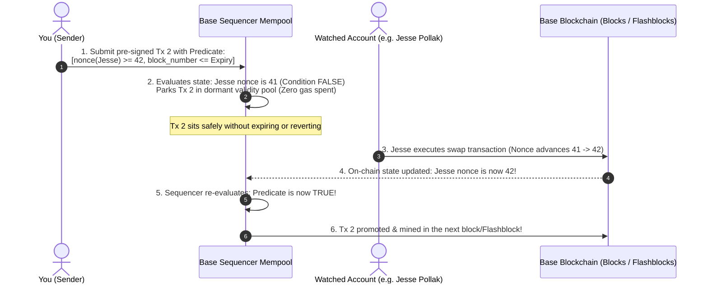

# Base Limit Orders & Validity Transactions

[](https://github.com/Surya512002/base-validity-transactions/actions/workflows/test.yml)
[](https://opensource.org/licenses/ISC)
[](https://base.org)
[](https://alchemy.com)

A production-grade implementation of on-chain limit orders, automated DCA, and **Base Validity Transactions** (featuring native `nonce`, `block_number`, `balance`, and `storage` predicates via Base's sequencer JSON-RPC method `base_sendRawTransactionValidity`).

---

## 📑 Table of Contents
- [Why Base Validity Transactions?](#-why-base-validity-transactions)
- [Architecture & Sequence Flow](#-architecture--sequence-flow)
- [Complete Feature Breakdown](#-complete-feature-breakdown)
  - [1. Nonce Validity Transactions](#1-nonce-validity-transactions)
  - [2. Cross-Account Trigger (The Jesse Pollak Example)](#2-cross-account-trigger-the-jesse-pollak-example)
  - [3. Zero-Gas Invalidation (Free Cancellation)](#3-zero-gas-invalidation-free-cancellation)
  - [4. Alchemy RPC Integration](#4-alchemy-rpc-integration)
  - [5. Limit Order Book Contract Features](#5-limit-order-book-contract-features)
  - [6. Autonomous Keeper Bot](#6-autonomous-keeper-bot)
- [Quickstart & Installation](#-quickstart--installation)
- [Environment Configuration (.env)](#-environment-configuration-env)
- [Step-by-Step Running Guide](#-step-by-step-running-guide)
  - [1. Test Auto-Trigger Queue (Base Sepolia)](#1-test-auto-trigger-queue-base-sepolia)
  - [2. Test on Base Mainnet](#2-test-on-base-mainnet)
  - [3. Test Zero-Gas Invalidation](#3-test-zero-gas-invalidation)
  - [4. Test Custom Recipient & Watched Address](#4-test-custom-recipient--watched-address)
  - [5. Run Smart Contract Test Suite](#5-run-smart-contract-test-suite)
  - [6. Run Math & Typecheck Checks](#6-run-math--typecheck-checks)
  - [7. Run the Autonomous Keeper Bot](#7-run-the-autonomous-keeper-bot)
  - [8. Deploy Contracts](#8-deploy-contracts)
- [Using the Validity SDK in Your Own Project](#-using-the-validity-sdk-in-your-own-project)
- [Frequently Asked Questions (FAQ)](#-frequently-asked-questions-faq)
- [Repository Structure](#-repository-structure)
- [License](#-license)

---

## 💡 Why Base Validity Transactions?

In traditional EVM, transaction nonces are strictly sequential ($0, 1, 2, ...$). If you want to:
- Run a conditional order or intent
- Execute a transaction **right after** another wallet executes (like copy-trading or conditional liquidations)
- Pipeline a multi-step workflow without deploying an orchestrator contract

You typically had to run a 24/7 off-chain listener bot that continuously polls the mempool, or rely on complex Account Abstraction relayers.

**Base changed this with the Cobalt upgrade**:
You can now submit an EIP-1559 signed transaction bundled with **state predicates** directly to the Base sequencer (`base_sendRawTransactionValidity`). The sequencer holds the transaction dormant in its validity pool and only executes it when your conditions evaluate to `true` on-chain.

---

## 🏗️ Architecture & Sequence Flow



---

## ⚡ Complete Feature Breakdown

### 1. Nonce Validity Transactions
* Evaluates an account's on-chain protocol transaction count.
* Supports comparison operators: `>=`, `=`, `<=`, `>`, `<`.
* Always paired with a `block_number` ceiling (`op: "<="`) so the transaction automatically expires after ~2 minutes if conditions are never met.

### 2. Cross-Account Trigger (The Jesse Pollak Example)
* You don't have to watch your own nonce; you can watch **any public wallet** on Base!
* **The Scenario:** Suppose you want to buy a token right after Jesse Pollak (@jessepollak) buys it.
* Instead of keeping an AWS server running 24/7 to monitor his wallet, you pre-sign your buy transaction and submit it to the Base sequencer with `address: JesseWallet` and `op: ">="`.
* The moment Jesse's transaction is mined on Base, your transaction fires automatically behind his!

### 3. Zero-Gas Invalidation (Free Cancellation)
* If you submit a transaction with strict equality (`op: "="`) bound to nonce $N$, and later change your mind:
* Simply broadcast any normal transaction from your wallet.
* Your nonce moves to $N+1$.
* The sequencer detects that the condition can never be met again and **automatically discards the conditional transaction without charging you any gas!**

### 4. Alchemy RPC Integration
* Powered by **Alchemy** (`dashboard.alchemy.com`) for high-throughput block subscriptions, real-time nonce tracking, and rock-solid reliability.
* Automatically activates whenever `ALCHEMY_API_KEY` is present in your `.env`.

### 5. Limit Order Book Contract Features (`LimitOrderBook.sol`)
* **Limit Buy**: Buy an asset when the market price drops to your trigger level.
* **Take-Profit & Stop-Loss**: Sell an asset when price hits upside or downside targets.
* **Trailing Stop**: A dynamic stop-loss that ratchets upward with price highs, locking in profits.
* **Bracket (OCO)**: Take-profit + stop-loss from a single deposit; when one fills, the other cancels automatically.
* **Edit in Place**: Change trigger prices or limits without withdrawing or re-creating orders.
* **Recurring Buys (DCA)**: Periodic buys on a fixed schedule with optional price ceilings.
* **Oracle-Bounded Fill Guard**: Reverts fills if Uniswap pool liquidity deviates beyond a set % of Chainlink oracle prices.
* **Stale-Price Protection & Always-Exit**: Freezes executions if feeds are stale, but users can always cancel and withdraw funds even if the contract is paused.

### 6. Autonomous Keeper Bot (`keeper/keeper.ts`)
* Monitors order books, ratchets trailing stops on new highs, fills triggered orders, refunds expired orders, and runs scheduled DCAs.
* **Validity Transaction Mode (`VALIDITY_TX=1`)**: Submits keeper executions with `block_number` ceiling bounds, guaranteeing transactions never execute late if mempool delays occur.

---

## 🚀 Quickstart & Installation

### Prerequisites
* [Node.js](https://nodejs.org/) v18.0.0 or higher
* npm v9.0.0 or higher

### Installation
```bash
# 1. Clone repository
git clone https://github.com/Surya512002/base-validity-transactions.git
cd base-validity-transactions

# 2. Install dependencies
npm install

# 3. Create local environment file
cp .env.example .env
```
*(On Windows PowerShell: `Copy-Item .env.example .env`)*

---

## ⚙️ Environment Configuration (`.env`)

Edit your `.env` file to customize settings:

| Variable | Description | Default / Example |
| :--- | :--- | :--- |
| `DEPLOYER_PK` | 32-byte private key for testing and deployments | `0x...` |
| `ALCHEMY_API_KEY` | *(Recommended)* Alchemy API Key from dashboard.alchemy.com | Optional |
| `TARGET_RECIPIENT` | Destination address for conditional transaction (Tx 2) | Defaults to sender account |
| `WATCH_ADDRESS` | Account whose nonce the sequencer monitors | Defaults to sender account |
| `NETWORK` | Target network (`base` or `baseSepolia`) | `baseSepolia` |
| `BASE_SEQUENCER_RPC` | Base Mainnet Sequencer endpoint | `https://mainnet-sequencer.base.org` |
| `BASE_SEPOLIA_SEQUENCER_RPC` | Base Sepolia Sequencer endpoint | `https://sepolia-sequencer.base.org` |
| `VALIDITY_TX` | Enable validity transactions for keeper bot (`1` or `0`) | `0` |

---

## 🧪 Step-by-Step Running Guide

### 1. Test Auto-Trigger Queue (Base Sepolia)
Demonstrates pre-signing Tx 2, verifying sequencer dormancy, and auto-executing when Tx 1 confirms:
```bash
npm run test:validity
```
*Note: If no private key is set, it safely runs in **dry-run mode**, validating payload construction and live schema against the sequencer.*

### 2. Test on Base Mainnet
Run live on Base Mainnet (Chain ID 8453):
```bash
npm run test:validity -- --mainnet
```
*(Requires ~0.0001 Base ETH for live broadcasting)*

### 3. Test Zero-Gas Invalidation
Demonstrates free transaction cancellation using strict nonce equality (`op: "="`):
```bash
npm run test:validity -- --mode invalidate
```

### 4. Test Custom Recipient & Watched Address
Configure targets directly from the CLI without editing `.env`:
```bash
npm run test:validity -- --to 0xRecipientWallet... --watch 0xWatchedWallet...
```

### 5. Run Smart Contract Test Suite
Executes all 47 unit & integration tests on Hardhat's in-process Cancun EVM:
```bash
npm test
```
*Expected: `47 passing`*

### 6. Run Math & Typecheck Checks
```bash
# Verify order math, fee deductions, and fill floors
npm run test:math

# Typecheck all TypeScript (contracts, keeper, SDK, scripts)
npm run typecheck
```

### 7. Run the Autonomous Keeper Bot
Run the keeper bot to monitor limit orders and execute DCA plans:
```bash
# Standard mode
npm run keeper

# With native Base Validity Transactions enabled:
# Set in .env: VALIDITY_TX=1
npm run keeper
```

### 8. Deploy Contracts
```bash
# Deploy testnet mocks to Base Sepolia
npm run deploy:sepolia-mocks

# Deploy production contracts to Base Mainnet
npm run deploy
```

---

## 📦 Using the Validity SDK in Your Own Project

You can import the typed helpers from `shared/validity.ts` directly into your own dApps or bots:

```typescript
import {
  sendRawTransactionValidity,
  createNoncePredicate,
  createBlockPredicate,
  createBalancePredicate,
} from "./shared/validity";

// 1. Sign your raw transaction using Viem or Ethers
const rawTx = await account.signTransaction({
  chainId: 8453, // Base Mainnet
  type: "eip1559",
  to: "0xDestination...",
  value: 0n,
  nonce: 5,
  ...gasOptions,
});

// 2. Define your validity predicates
const predicates = [
  // Trigger when target account reaches nonce >= 42
  createNoncePredicate("0xWatchedAccount...", ">=", 42),
  // Expire after block 60000000 (~2 minute timeout)
  createBlockPredicate("<=", 60000000n),
];

// 3. Dispatch directly to Base Sequencer
const txHash = await sendRawTransactionValidity(
  "https://mainnet-sequencer.base.org",
  rawTx,
  predicates
);

console.log("Transaction successfully queued in Base validity pool:", txHash);
```

---

## ❓ Frequently Asked Questions (FAQ)

#### Q: How does the sequencer know when to execute my transaction?
The Base sequencer monitors live state immediately before producing each block (and within 200ms Flashblocks). As soon as an on-chain transaction satisfies your predicate, your parked transaction becomes eligible and executes automatically.

#### Q: What happens if the watched nonce never reaches the target?
Because every validity transaction includes a mandatory `block_number` ceiling (e.g. `op: "<="`, targetBlock), the sequencer automatically discards the transaction once the chain passes that block height.

#### Q: Does it cost gas to park a transaction in the validity pool?
**No.** Storing and evaluating validity transactions in the sequencer pool costs zero gas. Gas is only consumed when the transaction is finally included in a mined block.

#### Q: Can I use this on Base Mainnet today?
**Yes.** Base Validity Transactions (`base_sendRawTransactionValidity`) are active on both Base Mainnet and Base Sepolia following the Cobalt upgrade.

---

## 📁 Repository Structure

```
├── .github/workflows/       # Automated CI build & test pipeline
├── contracts/               # Solidity contracts
│   ├── LimitOrderBook.sol   # Escrow, order types, DCA, and stop-loss logic
│   ├── UniswapV3Adapter.sol # Swap adapter for Uniswap V3 SwapRouter02
│   └── mocks/               # Testnet ERC20 & Chainlink price feed mocks
├── keeper/                  # Autonomous keeper bot (keeper.ts)
├── scripts/
│   ├── test-nonce-validity.ts  # Interactive CLI for Nonce Validity testing
│   ├── deploy.js               # Mainnet deploy script
│   ├── deploy-testnet-mocks.js # Base Sepolia deploy script
│   └── e2e/                    # End-to-end local integration tests
├── shared/
│   ├── validity.ts             # Base Validity Transactions SDK & builders
│   ├── abi.ts                  # Contract ABIs
│   └── orderMath.ts            # Price calculations & fill-floor helpers
├── test/                    # Hardhat contract test suite (47 tests)
├── .env.example             # Environment template
└── hardhat.config.js        # Hardhat compiler & network configurations
```

---

## 📜 License
This project is licensed under the [ISC License](LICENSE).
